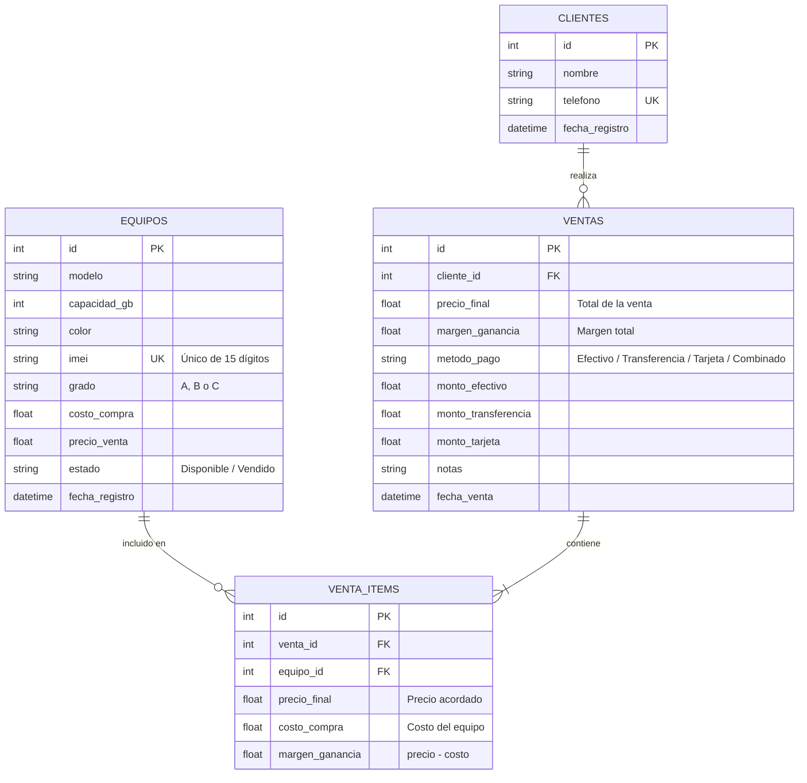

# Mi Inventario - Celulares Samuel Navarrete
### Sistema Web de Control de Inventario, Punto de Venta (POS), Garantías y Reportes

[](https://render.com/deploy?repo=https://github.com/samuelnavarrete1996/mi-inventario-celulares)

Sistema integral desarrollado para la comercialización, control de stock y punto de venta especializado en teléfonos celulares (seminuevos, reacondicionados y nuevos), con **carrito de compra multi-artículo**, soporte para **múltiples formas de pago (Efectivo, Transferencia, Combinado y Equipo Garantía)**, **módulo de devoluciones y cambios por garantía**, cálculo en tiempo real de márgenes de ganancia, gestión de clientes, emisión de notas de venta/recibos imprimibles y dashboard financiero.

---

## 🛠️ Stack Tecnológico

- **Backend:** Python 3.10+ / **FastAPI** (asíncrono, validación automática con **Pydantic v2**, documentación interactiva Swagger/OpenAPI).
- **Base de Datos:** **SQLite 3** con integridad referencial activa (`PRAGMA foreign_keys = ON`), transacciones atómicas e índices optimizados. Soporta cabecera de venta (`ventas`) y detalle de equipos (`venta_items`).
- **Frontend:** Single Page Application (SPA) con **HTML5 semántico**, **JavaScript vainilla** modular y **Tailwind CSS** (vía CDN), complementado con gráficos interactivos con **Chart.js**.

---

## 🗄️ Esquema de la Base de Datos



---

## 🚀 Nuevas Funcionalidades Implementadas

### 1. 🛒 Carrito de Compras Multi-Artículos (POS)
- Puedes agregar **tantos teléfonos celulares como desees** a la misma venta.
- Cada equipo agregado muestra su modelo, color, capacidad, IMEI y grado estético.
- Permite **editar el precio final individual** de cualquier equipo directamente en el carrito (para aplicar descuentos o promociones específicas a un equipo).
- Botón de eliminación rápida por equipo y botón para vaciar todo el carrito.
- Resumen financiero en vivo: **Total a cobrar**, costo total acumulado y **margen de ganancia neto** para el negocio.

### 2. 💳 Formas de Pago Flexibles y Pagos Combinados (Split Payments)
El sistema ahora incluye 4 opciones de pago con un solo clic:
- 💵 **Efectivo:** Muestra el total a pagar y cuenta con calculadora automática de cambio en vivo (*"¿Paga con cuánto?"* -> calcula el cambio a entregar).
- 📱 **Transferencia:** Total a transferir por banca electrónica o SPEI.
- 💳 **Tarjeta:** Total a procesar mediante terminal bancaria (débito/crédito).
- 🔀 **Combinado (Dividido):**
  - Permite cobrar parte en **Efectivo**, parte en **Transferencia** y parte en **Tarjeta** (por ejemplo: $5,000 en tarjeta y $3,000 en efectivo).
  - Incluye un validador en tiempo real que te indica si el monto asignado coincide exactamente con el total o cuánto dinero falta o sobra por asignar.

### 3. 🧾 Nota de Venta / Recibo Imprimible Detallado
- Desglosa **todos los celulares incluidos en la compra** con su IMEI respectivo y grado estético (para validación de garantía).
- Imprime el **desglose exacto de los métodos de pago utilizados** (ejemplo: cuánto se pagó en efectivo y cuánto en tarjeta).
- Botón **"Imprimir Recibo"** con formato optimizado mediante `@media print`.

---

## 🖥️ Ejecución Local

1. **Con un solo clic en Windows:**
   Haz doble clic sobre el archivo **`iniciar_servidor.bat`** en la carpeta principal.

2. **Por terminal:**
   ```bash
   python run.py
   ```

3. **Acceso Web:**
   - **Sistema Web:** [http://127.0.0.1:8000](http://127.0.0.1:8000)
   - **Documentación Swagger:** [http://127.0.0.1:8000/docs](http://127.0.0.1:8000/docs)
